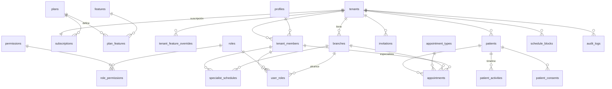

# Base de datos

PostgreSQL (Supabase). Dinero en `numeric(14,2)` + `currency` (COP). Timestamps `timestamptz` (UTC), mostrados en la zona del tenant (`America/Bogota` por defecto).

## ERD (Fases 01–02)

## Tablas

| Tabla | Propósito | Tenant/Sede | RLS (lectura · escritura) |
|---|---|---|---|
| `tenants` | Empresa (óptica) | — | miembro · `settings.manage` (columnas permitidas) |
| `branches` | Sedes | tenant | miembro · `branches.manage` |
| `profiles` | Perfil 1:1 de `auth.users` | — | uno mismo y co-miembros · uno mismo (columnas permitidas) |
| `tenant_members` | Membresía | tenant | uno mismo o `team.read` · `team.manage` |
| `roles` / `role_permissions` / `permissions` | RBAC (roles de sistema `tenant_id NULL` + personalizados) | tenant opcional | miembro · `roles.manage` |
| `user_roles` | Rol por usuario y sede (`branch_id NULL` = todas) | tenant + sede | uno mismo o `team.read` · `roles.manage` |
| `invitations` | Invitaciones (hash del token) | tenant + sede | `team.manage` |
| `plans` / `features` / `plan_features` | Catálogo SaaS | global | autenticados · solo migraciones |
| `subscriptions` | Suscripción del tenant | tenant | miembro · service role |
| `tenant_feature_overrides`, `global_feature_flags` | Feature flags | tenant/global | miembro · service role |
| `audit_logs` | Auditoría append-only | tenant | `audit.read` · solo triggers |
| `patients` | Paciente (CRM 360°) | tenant | `patients.read` · `patients.create/update` (archivar requiere `patients.delete`) |
| `patient_consents` | Consentimientos versionados (IP, UA) | tenant | `patients.read` · `patients.update` |
| `patient_activities` | Timeline | tenant | `patients.read` · triggers / `patients.update` |
| `appointment_types` | Tipos de cita (seed por tenant) | tenant | miembro · `schedules.manage` |
| `specialist_schedules` | Disponibilidad semanal | tenant + sede | `appointments.read` · `schedules.manage` |
| `schedule_blocks` | Vacaciones / bloqueos | tenant + sede | `appointments.read` · `schedules.manage` |
| `appointments` | Citas | tenant + sede | `appointments.read` · `appointments.create/update` |

## Índices y constraints destacados
- `patients_document_uq (tenant_id, document_type, document_number) where deleted_at is null`
- `patients_name_trgm_idx` (GIN trigram) para búsqueda global rápida
- `appointments_no_overlap` — `EXCLUDE USING gist (specialist_id =, tstzrange &&)` impide doble agenda
- Paginación keyset `(created_at desc, id desc)` en pacientes

## Funciones
| Función | Tipo | Uso |
|---|---|---|
| `private.is_member / has_permission / can_write / plan_limit / feature_enabled` | definer | Políticas RLS |
| `public.create_tenant(...)` | definer | Onboarding atómico |
| `public.my_permissions(tenant)` | definer | Gating de UI |
| `public.accept_invitation(hash)` / `invitation_preview(hash)` | definer | Invitaciones |
| `public.booking_catalog / booking_slots / booking_create` | definer, anon | Reserva pública |
| `public.dashboard_metrics / recall_opportunities[_count]` | **invoker** (respeta RLS) | Inicio |

## Migraciones
`supabase/migrations/*.sql`, aplicadas en orden por `npm run db:migrate`. Nunca editar una migración aplicada (el runner avisa por checksum).
